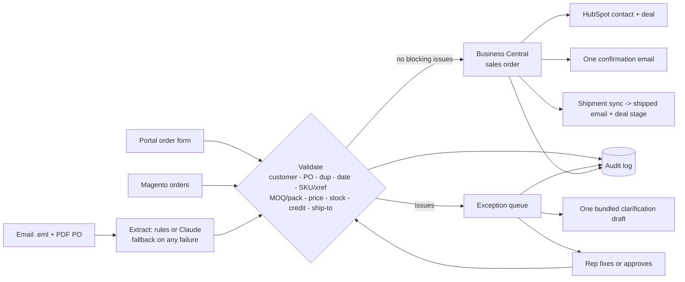

# Order-to-Cash Intake Automation

> A working prototype of the first problem a manufacturer's customer service team usually has: orders arrive as messy emails, PDFs and web orders, reps re-key them into the ERP, and customers get chased for missing details.
> Built for a fictional manufacturer (Northfield Fluid Systems). Runs fully offline; ERP, CRM and web store are simulated.

## The problem
Every order passes through a person who reads it, looks up the customer, checks part numbers, price, stock, credit and ship-to, types it into the ERP, and emails the customer when something is missing - often one issue at a time. It is slow, error-prone and generates avoidable back-and-forth.

## What it does
Email / PDF / portal form / Magento order -> **extract** (rules or Claude) -> **validate with deterministic rules** -> either **create the sales order in Business Central + HubSpot deal + one confirmation email**, or **route to an exception queue** with every customer-facing question bundled into **one drafted email** -> customer status page, shipment sync, audit trail, dashboard.

**Design principle: AI reads, code decides.** The LLM (optional) only transcribes a message into structured fields. Price, credit, stock, MOQ and duplicate decisions are plain, testable code. A near-miss part number is *suggested*, never silently corrected. If the CRM is down the order is still created and the failure is logged. If the LLM fails, the rules parser takes over.

## What's in this repo
| Path | Purpose |
|---|---|
| `otc/extract.py` | Rules parser (emails, tables, free text, quoted-reply stripping, description-only lines) + Claude extractor with fallback |
| `otc/validate.py` | All business rules and exception types (customer vs internal vs warning path) |
| `otc/pipeline.py` | Orchestration, overrides/re-validation, shipment sync, customer status lookup |
| `otc/connectors.py` | Business Central, HubSpot, Magento: mock clients (used) + live HTTP clients (unverified) |
| `otc/comms.py` | Bundled clarification drafts, confirmation/shipped emails, optional SMTP |
| `otc/synth.py`, `otc/seed.py` | Reproducible master data and ~100 deliberately messy synthetic orders with ground truth (real `.eml` + PDF files) |
| `otc/metrics.py` | KPIs (measured) vs rep-time model (assumption-based), evaluation against ground truth |
| `app/streamlit_app.py` | Rep dashboard, exception queue, customer portal (order form + status), systems view |
| `otc/api.py` | FastAPI endpoints for n8n / Power Automate |
| `workflow/n8n_order_intake.json` | Starter n8n workflow (IMAP -> API -> notify rep; Magento poll; portal webhook) |
| `docs/` | BC field mapping, Power Automate design spec |
| `tests/` | 16 tests incl. failure modes (CRM outage, ERP duplicate guard, LLM failure, quoted-reply noise) |

## Results on the synthetic run (`python run_demo.py`)
100 cases: 84 emails (6 with PDF attachments), 6 portal orders, 10 Magento orders.

**Measured**
- 48% touchless on first pass; 47 more confirmed after review; 3 duplicate POs discarded; 2 still waiting on finance approval
- 37 clarification emails carried 41 questions (a handful of cases had several issues, but most had one - bundling helps only on those)
- 1.32 customer emails per case overall (1 for every touchless order)
- 1-2 ms pipeline time per case with the rules extractor

**Against ground truth** (injected defects): exception precision 1.0, recall 1.0, 100/100 exact matches, 48/48 clean orders created with correct lines.
**Read that carefully:** the same author wrote the generator and the parser, so this is a *regression benchmark*, not evidence of real-world accuracy. Probing the parser with unseen phrasing found real gaps (see limitations); a real pilot would start by running the rules in shadow mode on a few hundred genuine orders.

**Modeled, not measured:** ~870 rep-minutes saved on the run, from editable assumptions (6 min/order base, 1.5 min/line, 5 min per customer email, 4 min per assisted case). Change them in the dashboard sidebar.

## What this demonstrates (mapped to the role)
- Process analysis -> automation design: exception taxonomy with customer/internal/warning paths and bundled communication
- Systems integration: ERP sales-order API shape, CRM upsert, web-store polling, shipment feedback loop, idempotency guard
- AI workflows done responsibly: constrained extraction, fallback, human approval on risk, audit log
- Customer-service impact: fewer emails, status self-service portal, faster rep review
- Adoption: non-technical rep screen with suggested fixes and a drafted reply
- Ownership: tests, docs, assumptions stated, measured vs modeled separated

## Honesty note and limitations
- **Business Central, HubSpot and Magento are simulated** (SQLite-backed mocks that mimic API shapes and ERP guards). The `Live*` clients follow vendor docs but were **never run against a real tenant**.
- **The LLM path is implemented but not benchmarked here.** Offline runs use the rules extractor.
- The Power Automate flow is a design spec only; the n8n JSON has not been import-tested.
- Rules parser gaps found by probing: quantities like "2 dozen" and "same as last time" produce a clarification (safe) rather than an order; numeric dates assume US m/d/y; description-only lines need a human or the LLM path.
- Stock is checked but not reserved; no tax, currency or substitutions; reply-parsing of customer answers is out of scope (reps enter the answer).
- Customer-answer and shipment steps in the demo are simulated using the ground truth.
